# Manuscript

Manuscript (formerly Textbox Tools) is a Supernote NOTE plugin for working on a typed text by pen:
mark edits by hand, review them, apply them; import text files and export.

It targets the Android-based Supernote plugin runtime only. It does not support iOS.

## Status

Manuscript is in beta. It changes NOTE page elements directly: try it on a copy of a note before
using it on an important notebook. It writes a backup of the pages before every change.

New to it? Open Manuscript and tap **?**: **Getting started** explains the buttons and the core
marks and puts a cheat sheet of the marks on a page of your choice.

### Known limits

- Developed and tested on the Supernote A5 X; the Nomad, Manta and other devices are beta.
- Made for portrait; landscape is untested.
- Fonts that come with the Supernote (for example 851tegakizatsu) can't be read by plugins: marks
  on textboxes in such a font are listed under To decide until you copy the font to
  `MyStyle/Manuscript/fonts` (see Fonts below).
- Handwriting recognition is the Supernote's own; tagged text can need a correction in the review.

## Edit marks at a glance

The same overview as **?** → Marks at a glance in Manuscript. Every mark has a page with a
before/after picture in the help; the pictures are also in [docs/user/images/marks](docs/user/images/marks).

|  | Mark | What it looks like |
|---|---|---|
| 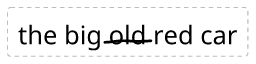 | **Delete** | A line through the words |
| 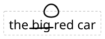 | **Replace** · + text | Strike, plus a small circle |
| 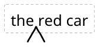 | **Insert** · + text | ∧ or V where the words go |
| 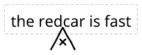 | **Space** | ∧ or V with a small cross |
| 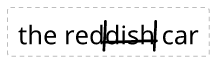 | **Delete letters** | Strike with two short lines |
| 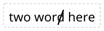 | **One letter** | A slash through it |
| 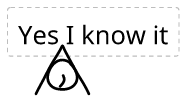 | **Punctuation** | ∧ or V with a filled circle |
| 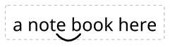 | **Close up** | An arc under the gap |
| 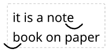 | **Close up at a line end, join** | Two arcs, end and start |
| 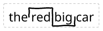 | **Swap** | Over one part, under the next |
|  | **Break at a word** | Step mark with a second line |
| 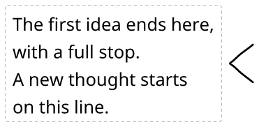 | **Break between lines** | < or > beside the text |
| 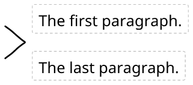 | **New paragraph** · + text | < or > between paragraphs |

**+ text:** Make the mark, then write the new words as the very next thing, anywhere on the page. Lasso them and tap Insertion or Replacement in the lasso toolbar.

Grey numbers are placed by Manuscript when you tag text. They pair the text with its mark; you never write them.

For a quick reference on the page, use **Put cheat sheet on this page** in Getting started:

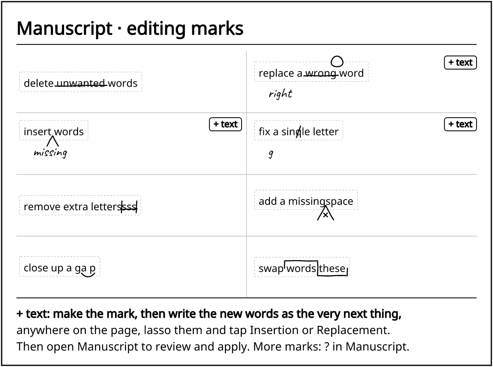

## Main Features

### Textbox Tools (lasso panel)

- Split one textbox into sentence-based or paragraph-based textboxes
- Join selected textboxes in reading order
- Clean repeated spaces
- Remove manual line breaks
- See every action's result before applying it; actions that don't fit the selection say why

### Edit Markers

- Recognize handwritten delete markers
- Recognize replace markers as a delete line plus a small loop, with the new text written as the very next thing after the mark, anywhere on the page, and tagged
- Single letters: a strike with two short lines across its ends deletes exactly what is between them; a slash marks one letter, also when drawn slanted
- Close up a space with an arc under the gap; join two lines or two paragraphs with two arcs
- Put in punctuation with a caret and a small circle holding the mark, without tagging
- Support both freehand strokes and Supernote straight-line geometry
- Review all changes before applying them: removed words struck through, replacements in bold, one textbox at a time
- Calibrate the text measurement (Manuscript → Settings → Calibration); Report a problem (Settings → Diagnostics) saves how the last marks were read, for bug reports

### Replacement and Insertion

- Tag handwritten new text with one lasso button, "Insertion or Replacement", instead of converting it to text first
- The mark drawn just before the text decides: a replace mark makes it a replacement, a caret an insertion; a small number at both shows which belong together
- No mark found? The text keeps a "?". Select mark: draw or lasso the mark and tap the button again; the "?" becomes its number and the text never needs to be written again. Or Insert right here: it becomes a new paragraph where its handwriting starts
- An insertion is written as the very next thing after a caret, anywhere on the page (a V on the line or a ∧ under it): between words, inside a word, or between paragraphs; paragraphs below move down to make room
- Manuscript recognizes the tagged text while you read, shows a picture of the handwriting, and lets you fix the text in place with the Supernote keyboard's handwriting input
- Fine-tune any change by one character (a comma, a space, a letter; a swap's three edges), and drop a change or an unused mark, keeping or erasing your handwriting
- The handwriting and its picture are kept in the plugin folder (`pen-edits/`)

### Comments and Images

- Keep handwriting beside the text as a comment or an image with the lasso button "Comment or Image": a small card asks which; a comment gets a speech bubble with "C", an image a plain double frame (circles stay for the numbers of tagged text)
- Comments and images never change the text: Apply leaves them alone
- Text without a mark ("?") can become a comment or an image, and back: on the tag's cards and under To decide
- Each belongs to the paragraph beside it; Manuscript's Notes tab lists them with their paragraph: read and correct a comment, choose another paragraph, tick it done, or drop it; an image goes before or after its paragraph
- The Outline counts the comments and images of each paragraph across the whole note
- Not exported; images are written to a linked file in a later version

### Manuscript

- The NOTE toolbar button "Manuscript" reads every edit mark on the current page
- Every change in reading order, the changed text in full with a few words around it; the selected change on the right with its text, its edges and Drop
- To decide, next to the changes: a numbered mark whose place stayed open (‹ › and Here), tagged text with a "?" (Select mark, Insert right here), strokes on the text that read as no clear mark (read as one of the marks offered, Ignore, Remove)
- The whole note: a page strip with each page's count of changes; tap a page, or read them all
- Apply every ready change of the pages read after the preview; one backup of those pages is written first
- Outline: the note's linked files and headings on the left, the open heading's paragraphs on the right, details below; change a heading's level (with or without its subheadings), move paragraphs within a heading or to another one, move files, set aside or delete a section; statuses (open, review, final) and a filter for edits waiting or not final; headings of chosen levels get a NOTE title for the table of contents
- A note imported linked to its text file: Apply also updates the file, and "Update <file>" writes changes made directly in the textboxes; untouched text is written back exactly, a file changed outside is never overwritten (Save as copy instead)
- Set aside: paragraphs and sections go to pages at the end of the note under one heading "Set aside"; everything there stays in the note only (never written to a file or exported), Show › Set aside lists it under your own headings, Move back puts it into the text again
- Move a block with ←, set it aside or delete it; the changes are planned first, each can be undone, and "Apply n changes" rebuilds the pages from the first change with one backup. A block with pending edits stays in place until its edits are applied
- Clean up layout: lay the whole note or one linked file out again with the current margins and sizes; long paragraphs are cut to fit, handwriting stays where it is
- Settings: the Outline's headings, the page layout (margins that leave room for handwriting, which headings start a new page, text sizes), the export rules, calibration and diagnostics

### Files: Import and Export

The Manuscript card's Files tab lists the linked files and opens the import and the export; a note
without textboxes opens there.

- Import plain text into NOTE textboxes, from a `.txt` file in any folder (for example `INBOX`), chosen with the Supernote file selector
- Split imported text into paragraph-based textboxes
- Link the import to its file: one textbox per heading, paragraph or list; frontmatter, code, tables, callouts and other blocks are kept exactly as they are and shown as framed placeholders
- Every linked file starts on a new page; headings can too (Settings → Layout)
- See the planned pages drawn to scale before importing; the preview updates by itself
- See which textboxes of the page, the note or a page range will be exported, as a list that updates by itself
- Export recognized textbox content into a DOCX file

## Fonts

Edit markers, Split, Join and Import measure text in the textbox's font, so they know where each
word sits. The system font and fonts you installed yourself (in `MyStyle/fonts`) work as they are.

The fonts that come with the Supernote, such as 851tegakizatsu, sit in a folder plugins can't
read. For those, put a copy of the font file in `MyStyle/Manuscript/fonts`, named exactly like
the font, for example `MyStyle/Manuscript/fonts/851tegakizatsu.ttf`. 851 Tegaki Zatsu is a
free font by 8:51:22 pm (http://pm85122.onamae.jp/); rename the downloaded
`851tegaki_zatsu_normal_0883.ttf`.

Without a readable font, the plugin shows a warning, because word positions and textbox sizes may
be wrong.

## Settings

The plugin remembers the import settings, the page layout, the export pages and rules, the
edit-marker calibration and the Outline's heading settings in `settings.json` in its own plugin folder. Tagged replacements and insertions are
kept in `pen-edits/` in the same folder, the Outline's block statuses in `block-status.json`, and
what a linked import came from (the file's path and its original text) and which files a note is
linked to in `sources/`, together with each linked file's text before the plugin's latest write
to it. Getting started is shown by itself only once (`onboarding` in `settings.json`). What the
plugin reads and writes in detail: [PRIVACY.md](PRIVACY.md).

## Installation

1. Download the latest `manuscript-<version>.snplg` from
   [GitHub Releases](https://github.com/tilmanbergt/manuscript/releases). Betas of the next
   version are there too, marked as pre-releases.
2. Copy the `.snplg` file to the `MyStyle/` folder on your Supernote device.
3. On the device, open Settings → Apps → Plugins.
4. Install it, over the version you have: your notes and settings are kept.
5. Open a NOTE file and use the plugin toolbar buttons.

Developed and tested on the Supernote A5 X; other devices are beta.

## Support

Something wrong? Right after it happens, open Manuscript → Settings → Diagnostics → **Report a
problem**. It saves one file to EXPORT with the version, device, settings, how the last marks were
read and the errors of this session - your text only if you tick it. Attach it to a bug report.

- Bugs, ideas and questions: [GitHub Issues](https://github.com/tilmanbergt/manuscript/issues)
  (the forms ask for what helps).
- What the plugin reads and writes: [PRIVACY.md](PRIVACY.md). It uses the network only when you
  tap Download in Import from URL.
- Security problems, privately: [SECURITY.md](SECURITY.md).
- Contributing: [CONTRIBUTING.md](CONTRIBUTING.md).

## Project Structure

A tour of the code, build instructions and the developer documents are in
[docs/dev/README.md](docs/dev/README.md). How the plugin is built:
[docs/dev/design-overview.md](docs/dev/design-overview.md). Rules for every change:
[docs/dev/DEVELOPMENT-POLICY.md](docs/dev/DEVELOPMENT-POLICY.md).

## Development

The project uses npm (`package-lock.json`).

Install dependencies:

```sh
npm ci
```

Check your changes (type check, ESLint with zero warnings, Jest):

```sh
npm run check
```

Build the plugin package on Windows:

```powershell
./buildPlugin.ps1
```

The build writes the `.snplg` file to `build/outputs/`.

## License

MIT, see [LICENSE](LICENSE).
